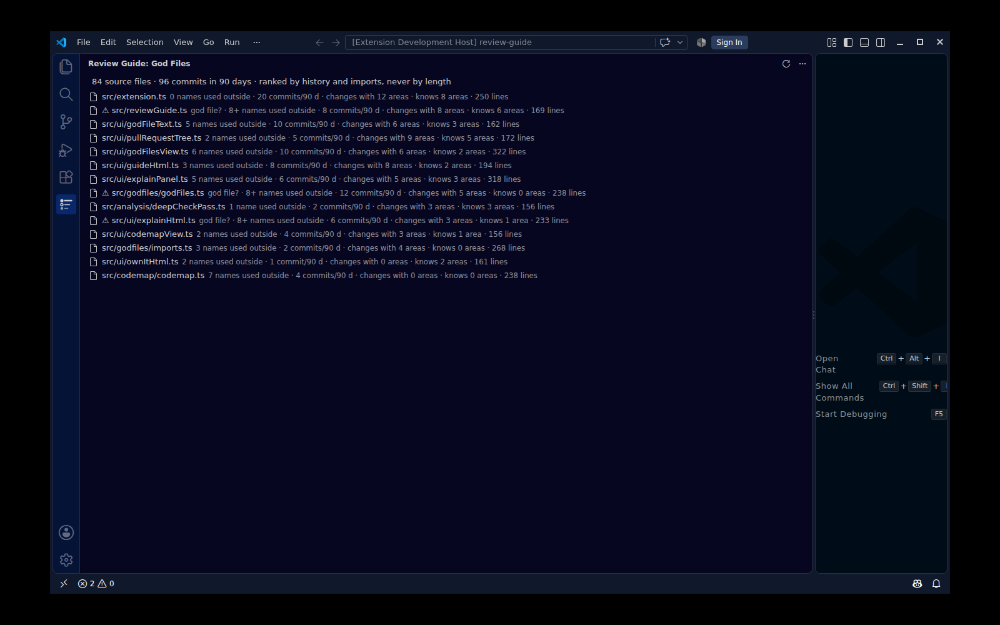
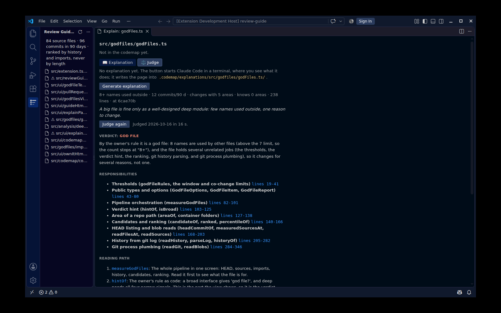

<h1 align="center">
  <picture>
    <source media="(prefers-color-scheme: dark)" srcset="docs/assets/review-guide-logo-dark.png">
    
  </picture>
</h1>

<h3 align="center">A VS Code extension that helps you own your code again: a codemap of what matters in your repo, a visual explanation per path, and pull requests pre-sorted with Claude so you read the critical changes first.</h3>

<p align="center">
  
  
  
  
  
  
</p>

<p align="center">
  <a href="#quickstart">Quickstart</a> ·
  <a href="#how-it-works">How it works</a> ·
  <a href="#codemap">Codemap</a> ·
  <a href="#god-files">God files</a> ·
  <a href="#safety">Safety</a> ·
  <a href="SPEC.md">Spec</a>
</p>

Review Guide does not review for you.
It sorts your attention, explains the code in plain words and asks you questions; the merge stays yours.
Its goal is ownership: understanding what your code does again, even when an agent wrote it.

---

## Why this exists

Agents write code faster than anyone can read it.
The pressure moved from writing to reviewing, and the easy failure is to believe you reviewed carefully while you only skimmed.
Addy Osmani describes a loop that sorts pull requests like this: "The loop doesn't merge anything. It sorts my attention, and the merge stays mine." ([Agentic Engineering](https://www.oreilly.com/library/view/agentic-engineering/0642572392291/), chapter 1)

GitHub shows a pull request as a flat list of files.
Review Guide turns it into a reading order:

- **critical first**, sorted by the damage a quiet bug would do, not by how hard the code looks;
- **questions for you** at the lines that matter, with what Claude checked and where it looked;
- **a check that you understood**, not only that you scrolled past.

## How it works

```
 GitHub PR ──► own worktree ──► review units ──► pass 1: tier + why ──► pass 2: questions ──► you
               (your working    (one per changed   (critical / check /     (critical units:       explain it,
                copy untouched)  function)          skim, cached)           plain words, lines,    chat with Claude
                                                                            what to check)         until "understood"
```

1. **Lists the open pull requests** of your repos, after you sign in with VS Code's own GitHub login.
2. **Checks a PR out into its own folder** (a git worktree in the extension's storage).
   Your working copy is never touched.
3. **Splits the PR into review units**: one per changed function, method or class body, found with the document symbols of your language extensions.
4. **Pass 1 (overview)**: Claude gives every unit a tier (critical / check / skim) and one sentence why.
   A test change that removes an assertion, loosens a tolerance or adds a skip is always critical: the agent must not grade its own work.
5. **Pass 2 (deep check)**: for every critical unit, Claude explains the code in plain words, with an ASCII diagram and an everyday analogy where that helps, and writes questions for you, each tied to lines of the new code.
   It lists what it checked (and where), what only you can check, and what it could not confirm.
   Above 25 critical units it asks you first.
6. **Ownership check**: for a critical unit you write what the code does and why it is correct.
   Claude answers "understood", "almost" (with what is missing) or "not yet" (with what is wrong), and you can reply and ask back until it clicks.
   Claude's own summary stays folded until you have tried: reading an answer is not understanding it.
7. **The 3am check** in the PR header says how many critical units you understood, read, or have not read; "owned" only when all are understood.
   The **Ownership** view sums this up per file of the repo.

## Quickstart

Review Guide is not on the Marketplace yet.
Download `review-guide.vsix` from the [latest release](https://github.com/gapsong/review-guide/releases/latest) and run `code --install-extension review-guide.vsix`, or build it from source.

Requirements:

- VS Code 1.95 or newer and git (Node.js 22 or newer only to build from source).
- [Claude Code](https://claude.com/claude-code) installed and logged in with your own account (subscription or API key).
  The extension starts your local, unmodified `claude`; it never sees, stores or forwards your login.

```
git clone https://github.com/gapsong/review-guide
cd review-guide
npm install
npm run package
code --install-extension review-guide.vsix
```

Then, in VS Code:

1. Open a folder of a GitHub repo and click **Review Guide** in the activity bar.
2. Allow the GitHub login once.
3. Open a pull request, wait for the overview, and start at the top of **Critical**.

If VS Code cannot find `claude` (common when VS Code is started from the Dock), set `reviewGuide.claudePath` to the full path, e.g. `~/.local/bin/claude`.

## Settings

| Setting | Default | What it does |
|---|---|---|
| `reviewGuide.repositories` | `[]` | Repos (`owner/name`) whose open PRs are listed. The GitHub repo open in VS Code is always listed. |
| `reviewGuide.claudePath` | `claude` | Path of the Claude Code CLI. |
| `reviewGuide.model` | `claude-opus-5-5` | Model for both passes and the ownership check. |
| `reviewGuide.githubApiUrl` | `https://api.github.com` | GitHub REST API address. |
| `reviewGuide.codemapFile` | `.codemap/codemap.yaml` | Your codemap, relative to each workspace folder. |
| `reviewGuide.explanationLanguage` | `English` | The language generated codemap explanations (and the God Files judgments) are written in. |
| `reviewGuide.godFiles.minLines` | `150` | God Files: files are ranked from this many code lines on. |
| `reviewGuide.godFiles.exclude` | `[]` | God Files: globs of paths to leave out, e.g. `docs_src/**`. Tests, generated and vendored code are always left out. |
| `reviewGuide.complexipyPath` | `complexipy` | God Files: the complexipy CLI for the cognitive complexity of Python files (user settings only). |

## Repo profile: `.review-guide.md`

A short file in the root of your repo that tells Claude what matters there, which the code alone cannot tell: what is critical, what the source of truth is, what to skim.

```markdown
## Critical
- Quantization formula, STE, packing layout, merge fold
- Save / load format, config defaults

## Source of truth
- The official implementation and the paper's formulas

## Skim
- Docstrings, log messages, README
```

It is read from the PR's base branch, so a PR cannot change its own rules.
Without one, Claude uses general rules and writes a draft for you; the extension never writes into your repo.

## Codemap

Pull requests are one way to own code; knowing the map of your repo is the other.
The codemap is your own map: a personal YAML file, `.codemap/codemap.yaml`, with one sentence and a label per important folder or file.
Keep it out of git (add `/.codemap/` to `.gitignore`).

```yaml
- path: shop/checkout/payment.py
  says: The only way to the payment provider. Reserves the amount first, then charges it.
  label: money        # money 💰 | security 🔒 | core ⚙️ | feature 🧩 | util 🧰
  deep: true          # optional: a deep module 🧠 (small interface, much hidden logic)
  why: A wrong amount is charged to a real card.          # optional notes, shown on hover
  watch: The provider retries on timeout, so a charge must be idempotent.
  start: shop/checkout/payment.py:42                      # where to start reading
  mine: |                                                 # your own words
    First reserve, then charge. The receipt is written last.
```

- **The Codemap view** (in the Explorer, below the files): your codemap as a tree, each entry with its badge and sentence. Hover for the notes, click to open, press "Explain" for the panel. Filter to money, security or deep modules in the view's title.
- **CodeLens**: a file in the codemap shows its badge and sentence above its first line, with "Explain".
- **Change markers**: when a commit changes a path after you last confirmed its entry, the view, the CodeLens and the Explain panel mark it "Changed since you confirmed it (2 commits)". Press **Still true** when the sentence still holds, or **Explain again** for a new explanation. Nothing refreshes by itself, and only commits count, not unsaved or uncommitted edits.
- **Own it**: do you own an entry? Write how it works in your own words (`mine`), then press **Check my words** (in the Explain panel's "🎯 Own it" view, from the CodeLens or the view's context menu). One read-only Claude call on a clean copy of your last commit answers understood, almost (with a question) or not yet (with file:line). It sees your entry and your words, never the chat or the explanation page. Next to it, a chat with Claude as your tutor: ask back as often as you like; its verdicts are only hints, so put what you learned into `mine` ("Use my last message as mine" copies it as a block) and check again. An understood entry shows "✅ owned" in the view; a commit that touches its path takes that away until you check again, and **Show changes** shows what changed since your check. The view's first line is your 3am check: "3am 💰🔒: 2 of 9 owned · … · next: payment.py", and **Own Next** opens that entry.
- **Badges in the Explorer**: every listed path shows its label's emoji (and 🧠 for a deep module); hover for the sentence. VS Code hides a folder's badge while the folder holds changed files; the Codemap view always shows it.
- **Problems view**: a moved or deleted path, a typo in a label, a sentence over 160 characters (notes have their own limits), a path listed twice: each shows on its line as soon as you save.
- **Explain** (right-click a file or folder, or "Review Guide: Explain" for the open file): a panel with the entry and the visual explanation from `.codemap/explanations/<path>/index.html`.
- **Generate explanation**: starts Claude Code in a terminal, where you see every step and answer its permission prompts. It writes the page (with screenshots, steppers and GIFs, using the `explain-visually` skill when you have it) into that folder, shaped by the label: for money, where cost is decided and who loses money; for security, where a secret lives and which attack the code stops. The panel shows the page as soon as it is written.

## God files

Where does owning this repo hurt most? The rule: **a big file is fine only as a well-designed deep module.**
The God Files view (Review Guide side bar) ranks files by how often they had to change and how much of the repo they know, never by length, then asks VS Code's language servers how much of each file other files use:

```
GOD FILES                                                         [refresh]
├─ ⚠ src/shop/checkout.py   god file? · 8+ names used outside · 66 commits/90 d · changes with 9 areas · knows 4 areas · 1,176 lines
├─ ✓ src/billing/ledger.py  deep · 3 names used outside · 4 commits/90 d · changes with 1 area · knows 1 area · 780 lines
└─ …                       click: open at the hardest function · right-click: Judge with Claude
```



- **names used outside**: the file's top-level names and the public members of its classes, exported objects and namespaces (`Model.merge`, `api.get`) that other source files use, found with "Find All References" of the language server (the TypeScript server built into VS Code; Pylance or another Python language server for Python). Tests are not users, and an import line is not a use, so a barrel owns no re-exported name. Counting stops at "8+". "…" while measuring; "–" when no language server answers (the tooltip says why), never 0. A TypeScript or JavaScript project needs a `tsconfig.json` or `jsconfig.json`, or the TypeScript server sees only the open files.
- **commits/90 d**: commits in the 90 days before HEAD; each is a reason the file had to change.
- **changes with N areas**: the areas (`apps/api`, `packages/ui`, `shop`) of the files that changed in the same commits. Sweeps (commits of more than 25 files) do not count.
- **knows N areas**: the other areas the file imports from.
- **lines**: code lines, shown but never part of the score.
- The ranking uses commits, co-change areas and known areas, so it is there at once and the same every time; the names fill in for the 20 files shown.
- The hint is only a hint: `god file?` above 7 names used outside; `deep` needs 1 to 7 names used outside, at least 300 code lines, at most 3 co-change areas and at most 3 known areas. A file nothing uses gets no hint. The tooltip explains each number, and warns when your codemap calls a broad file `deep: true`.
- **Hardest function** (tooltip; a click opens the file there): the function with the highest [cognitive complexity](https://www.sonarsource.com/docs/CognitiveComplexity.pdf), where reading is hard. It is never part of the score or the hint. TypeScript and JavaScript are measured inside the extension; Python needs [complexipy](https://complexipy.com) (`uv tool install complexipy`, or set `reviewGuide.complexipyPath`). Both read copies of your last commit in a temporary folder.
- Tests, generated and vendored code are left out. Nothing is sent anywhere or written into the repo.

**Judge with Claude** (right-click a file): one read-only Claude Code run on a clean copy of your last commit. It answers with a verdict (god file, deep module, hub, ok) and why, the file's responsibilities with their lines, a reading path of 3 to 5 functions, and keep whole or split. The judgment shows in the Explain panel's "Judge" view and is kept for that file and commit.



## Safety

- The review runs (both passes and the ownership chat) are read-only: Claude's only tools are Read, Grep and Glob.
  No shell, no edit, no write, no web.
  Project and user settings files, hooks and MCP servers are not loaded for these runs (`--restricted --strict-mcp-config`).
  An automated test (S1) asks Claude to edit a file, run a shell command and fetch a URL, and checks that the repo stays byte for byte the same.
- Claude gets no shell, not even for git: `git log --output=<file>` can write files.
  The extension runs git itself and hands Claude the output as files to read.
- PR code is never executed.
- The one run that is not read-only is "Generate explanation" for the codemap: it may run your app to take screenshots and it writes the page into `.codemap/explanations/`.
  It starts only when you press the button, runs visibly in a terminal under Claude Code's normal permission prompts, and gets the prompt as one argument with no shell in between.
  The explanation page is shown without network access and cannot send anything to the extension.
- Nothing is posted to GitHub.
  The GitHub token stays in VS Code's secret storage.
- Everything Claude writes is escaped before it is shown; the panel renders Markdown without passing any HTML through.
- Your read marks and explanations are stored locally and are only sent to your local Claude.
- "Judge with Claude" in the God Files view is read-only too, starts only when you ask, and runs in the same copy of your last commit with no shell and no git; the prompt carries the commit subjects and the numbers (S1 tests it on a file whose comments tell Claude to attack). The measurement itself uses no Claude and no network; complexipy runs without a shell on copies in a temporary folder, and its path can only be set in your user settings, not by a workspace.
- "Check my words" and the codemap chat are read-only too, and run in a copy of your last commit in the extension's storage, not in your folder: an ignored `.env`, untracked files and the `.codemap` folder never reach Claude (S1 tests this with a real `.env`). Your `mine` and the chat are only sent to your local Claude.

## Development

```
npm test          # lint, type check, unit tests, the S1 safety test (real Claude, haiku),
                  # VS Code integration tests, the .vsix package test
npm run package   # builds review-guide.vsix
```

Integration tests run in a real VS Code downloaded into `.vscode-test/`, under `xvfb-run` when there is no display.
They run on Linux and macOS.

[SPEC.md](SPEC.md) is the contract: the goal, every done criterion (F1-F16, C1-C13, S1, Q1-Q3, R1) and the code style.
[REPORT.md](REPORT.md) says which test proves which criterion, and [DECISIONS.md](DECISIONS.md) records the choices the spec left open.

## Status

Alpha, built for one person's reviews first.
All automated criteria pass.
On the first real test PR (3,400 lines), every change on the reviewer's gold list was tiered critical and the overview arrived after 75 s.
Too many other changes were tiered critical as well (25, target at most 10); the repo profile is the place to tune that.

## License

MIT

Review Guide is an independent project and is not affiliated with or endorsed by Anthropic.
Claude and Claude Code are trademarks of Anthropic.
